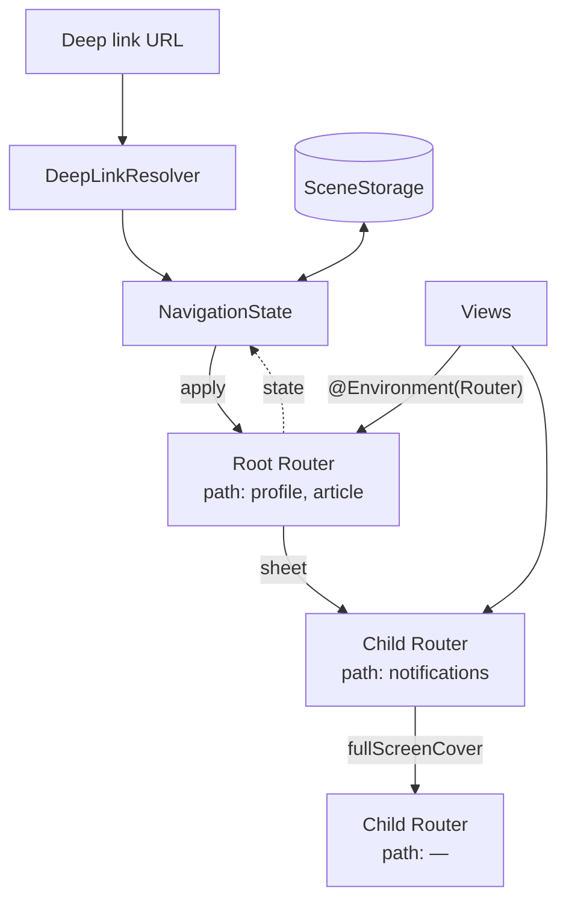

# Waypoint

[](https://github.com/DeepakPal25/Waypoint/actions/workflows/ci.yml)


Type-safe navigation for SwiftUI. Push routes, present modals, handle deep links, guard access, and restore state on relaunch — all without `NavigationLink(destination:)` scattered through your views.

```swift
enum AppRoute: Route {
    case profile(userID: String)
    case article(id: Int)
    case settings
    case login
}

router.push(.article(id: 42))
router.present(.login)
router.handle(url, with: deepLinks)  // myapp://articles/42 or https://example.com/articles/42
```

Routes are plain data — test them without a UI, serialize them to disk, reach them from a URL.

## What's included

| | |
|---|---|
| **Type-safe routes** | Routes are a `Hashable & Codable` enum. No stringly-typed destinations, no type erasure. |
| **Router per stack** | `Router` owns a `NavigationStack` path plus whatever sheet or cover sits on top of it. |
| **Nested modals** | Every modal gets its own child router and stack, to any depth. `dismiss`, `dismissPresented` and `dismissAll` work from anywhere in the tree. |
| **Deep links** | Pattern matching (`users/:id`, `docs/*`) for custom schemes and universal links, with host allow-listing. |
| **Route guards** | Redirect, present login, or deny before navigation commits. Child routers inherit them automatically. |
| **State restoration** | One modifier saves the whole hierarchy — stacks, modals, every tab — to `SceneStorage`. |
| **Tabs** | `TabRouter` gives each tab its own stack, handles tab-targeted deep links, and pops to root on re-select. |
| **Testable** | Routers are plain `@Observable` objects — unit-test navigation logic without rendering anything. |

## Installation

```swift
.package(url: "https://github.com/DeepakPal25/Waypoint.git", from: "1.0.0")
```

## Usage

### 1. Declare routes and map them to views

```swift
enum AppRoute: Route {
    case profile(userID: String)
    case article(id: Int)
    case settings
    case login
    case upgrade
}

extension AppRoute {
    @MainActor @ViewBuilder
    var view: some View {
        switch self {
        case .profile(let id): ProfileView(userID: id)
        case .article(let id): ArticleView(id: id)
        case .settings: SettingsView()
        case .login: LoginView()
        case .upgrade: UpgradeView()
        }
    }
}
```

Use identifiers as associated values, not full models — routes need to round-trip through `Codable` when they're saved and restored.

### 2. Host a stack

```swift
struct RootView: View {
    @State private var router = Router<AppRoute>()

    var body: some View {
        RouterStack(router: router) {
            HomeView()
        } destination: { route in
            route.view
        }
        .navigationRestoration(router)
        .onOpenURL { router.handle($0, with: .app) }
    }
}
```

### 3. Navigate from any view

```swift
struct ArticleRow: View {
    @Environment(Router<AppRoute>.self) private var router
    let article: Article

    var body: some View {
        Button(article.title) { router.push(.article(id: article.id)) }
    }
}

struct LoginView: View {
    @Environment(Router<AppRoute>.self) private var router

    var body: some View {
        Button("Done") { router.dismiss() }  // closes the sheet this view lives in
    }
}
```

| Call | Effect |
|---|---|
| `push(_:)`, `pop(count:)`, `popToRoot()` | Stack operations |
| `pop(to:)` | Back to the most recent matching route |
| `setStack(_:)` | Replace the whole stack at once |
| `present(_:style:)` | Sheet or full-screen cover with its own stack |
| `dismiss()` | Close the modal this router lives in |
| `dismissPresented()` | Close the modal this router presented |
| `dismissAll()` | Close every modal in the app |
| `state` / `apply(_:)` | Snapshot or restore the whole hierarchy |

### Deep links

```swift
extension DeepLinkResolver where Output == NavigationState<AppRoute> {
    static var app: Self {
        var links = Self(schemes: ["myapp"], hosts: ["example.com", "www.example.com"])

        links.register("users/:id") { match in
            match["id"].map { NavigationState(path: [.profile(userID: $0)]) }
        }
        links.register("articles/:id") { match in
            match.int("id").map { NavigationState(path: [.article(id: $0)]) }  // nil if not a number
        }
        links.register("settings/*") { _ in
            NavigationState(path: [.settings])
        }
        links.register("login") { _ in
            NavigationState(presented: .init(style: .sheet, root: .login))
        }
        return links
    }
}
```

- `myapp://users/42` and `https://example.com/users/42` resolve with the same handler.
- Hosts not on the allow-list are silently ignored.
- Patterns are tried in registration order; returning `nil` from a handler falls through to the next match.
- A deep link that fires while a sheet is open will dismiss the sheet before navigating.

### Route guards

```swift
let router = Router<AppRoute> { route in
    switch route {
    case .settings where !session.isSignedIn:
        .present(.login, style: .sheet)
    case .article(let id) where Paywall.isLocked(id):
        .redirect(.upgrade)
    default:
        .allow
    }
}
```

Guards run on every `push` and `present`, and child routers inherit them. Restored state and deep links skip guards — if a link needs to be gated, check access inside the destination view instead.

### Tabs

```swift
enum Tab: String, Codable, Hashable { case home, search, account }

struct AppView: View {
    @State private var tabs = TabRouter<Tab, AppRoute>(initial: .home)

    var body: some View {
        TabView(selection: tabs.selectionBinding) {
            RouterStack(router: tabs.router(for: .home)) { HomeView() } destination: { $0.view }
                .tabItem { Label("Home", systemImage: "house") }
                .tag(Tab.home)
            RouterStack(router: tabs.router(for: .account)) { AccountView() } destination: { $0.view }
                .tabItem { Label("Account", systemImage: "person") }
                .tag(Tab.account)
        }
        .navigationRestoration(tabs)
        .onOpenURL { tabs.handle($0, with: tabLinks) }
    }
}

var tabLinks = DeepLinkResolver<(tab: Tab, state: NavigationState<AppRoute>)>(schemes: ["myapp"])
tabLinks.register("account/settings") { _ in (tab: .account, state: NavigationState(path: [.settings])) }
```

### Testing navigation

```swift
@Test @MainActor func signedOutUsersSeeLogin() {
    let router = Router<AppRoute> { $0 == .settings ? .present(.login, style: .sheet) : .allow }

    router.push(.settings)

    #expect(router.path.isEmpty)
    #expect(router.sheet?.root == .login)
}
```

## Architecture



## Design decisions

**Navigation is state.** Every screen the user can be on is a `NavigationState` value. Deep links, restoration, and tests all produce or consume that same type — there's nothing to keep in sync.

**One router per stack, not a global one.** A single global path sounds simple until you have sheets inside sheets. Each `NavigationStack` and each modal gets its own router, and SwiftUI's environment hands it to whichever view needs it. No more guessing which stack a push should go to.

**Typed `[Route]` instead of `NavigationPath`.** `NavigationPath` is type-erased, which makes it impossible to assert on in tests or diff at restore time. A plain typed array can be sliced, encoded, and compared directly.

**Recursive state via a one-element array.** A struct can't hold an optional of itself, so `NavigationState` stores its modal in a `[ModalState]` capped at one element, with a computed property to make it feel optional. Unlimited nesting, plain `Codable`, no wrapper types needed.

**Custom schemes and universal links use the same patterns.** Internally the custom scheme host is treated as the first path segment, so `myapp://users/42` and `https://example.com/users/42` resolve with the same handler. One place to register a route.

**Deep links reset modals first.** A link that arrives while a sheet is open shouldn't navigate inside the sheet — it applies to the root and closes everything above it. The alternative is confusing.

**Guards are synchronous.** Navigation needs to respond on the same frame the user taps. If you're waiting on a session check, load it before the user can navigate and let the guard read the cached result.

**Restoration fails safe.** If a saved route can't be decoded after an app update, the app opens at root. Better than a crash.

## Requirements

- Swift 6.0+ / Xcode 16+
- iOS 17+, macOS 14+, tvOS 17+, watchOS 10+, visionOS 1+

## Roadmap

- [ ] Async route guards with a loading state
- [ ] `NavigationSplitView` coordinator
- [ ] Route analytics hook (pairs with [Beacon](https://github.com/DeepakPal25/Beacon))
- [ ] Generated deep-link documentation from registered patterns

## License

MIT. See [LICENSE](LICENSE).
